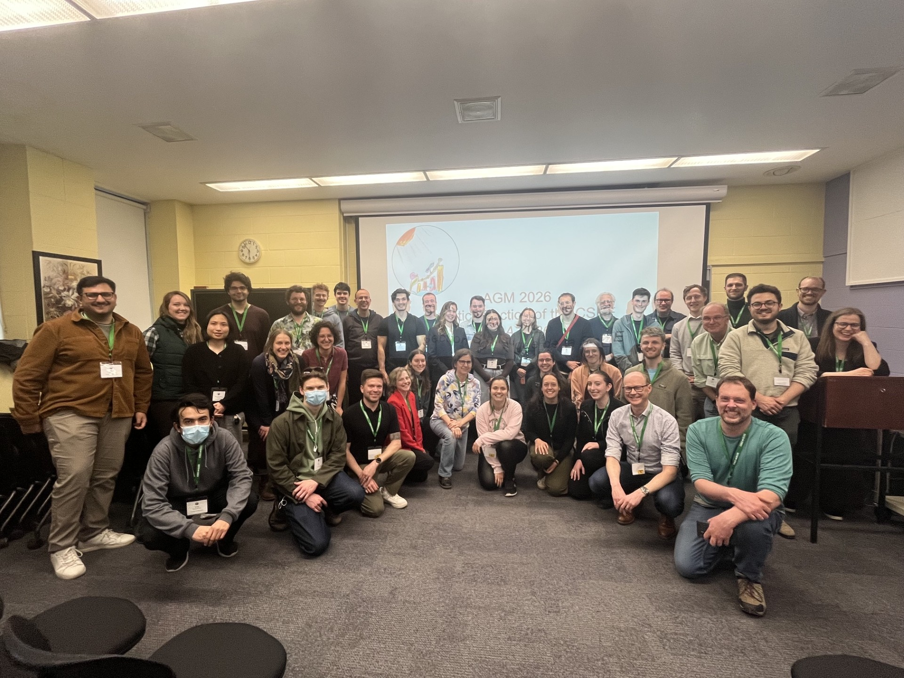

### 2027 Annual CSEE Conference - Case Study Competition

We are excited to announce that the Statistics Section will be hosting the inaugural data analysis Case Study Competition at the 2027 Annual CSEE conference. The competition is designed to engage students in the analysis of large and complex ecological or evolutionary data. Teams of 2 to 5 students supported by a faculty/post-doc mentor will work together to analyse a selected data set and will present their work in poster format at the 2027 Annual Meeting of the CSEE. Posters will be judged by members of the Statistics Section, and prizes will be awarded for the best submissions.

Full details are available [here](documents/csee_datathon_2026_2_english.pdf). Data for the analysis are available [here](documents/csee_2027_case_study.zip).

### May 13, 2026 5pm - Inaugural AGM & mixer ([Minutes](documents/minutes_2026_agm.pdf "2026 AGM Minutes"))

{fig-alt="2026 AGM Group Photo" fig-align="center"}

We will be holding our first AGM and mixer during the upcoming CSEE Annual Meeting in Toronto. The event will be held from 5-7:00pm on May 13 in the [Ramsay Wright Laboratorie](https://maps.app.goo.gl/KUruQs6PDXhPzEhB9) room 432 (RW432). We expect the AGM to last for half-an-hour. Food and non-alcoholic drinks will be provided during the mixer.

Please complete the [online registration form](https://forms.office.com/r/xMxvKLWFZv) if you would like to attend.
