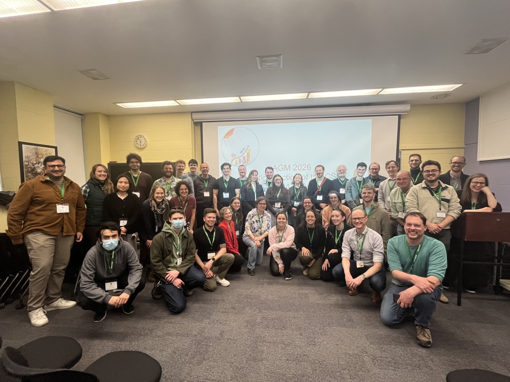

### **Conférence Annuelle 2027 de la SCÉÉ –** Compétition *Cas d’étude* 

Nous avons le plaisir d’annoncer que la section Statistique organisera, lors du conférence annuelle 2027 de la SCÉÉ , la toute première compétition d’analyse de données sous forme d’étude de cas. La compétition invite les étudiantes et les étudiants à participer à l’analyse de données écologiques ou évolutives volumineuses et complexes. Des équipes composées de 2 à 5 étudiantes et étudiants, encadrées par un professeur ou un stagiaire postdoctoral, travailleront ensemble à l’analyse d’un jeu de données sélectionné et présenteront leurs travaux sous forme d’affiches lors du congrès annuel 2027 de la SCÉÉ. Les affiches seront évaluées par des membres de la section Statistiques et des prix seront décernés aux meilleures contributions.

Les instructions sont disponsible [ici](documents/csee_datathon_2026_2_francais.pdf). Les données sont disponsible [ici](documents/csee_2027_case_study.zip).

### AGA inaugurale & réception ([Minutes](documents/minutes_2026_agm.pdf))

{fig-alt="AGA 2026"}

Notre première assemblée générale annuelle (AGA) aura lieu lors de la prochaine conférence annuelle de la SCEE à Toronto et sera suivi d'une réception. L'événement aura lieu de 17 h à 19 h le 13 mai dans les [Ramsay Wright Laboratories](https://maps.app.goo.gl/d7SBVUoZSyV8cgJ48), salle 432 (RW432). L'AGA devrait durer \~30 minutes. Des boissons non-alcooliques et des amuse-gueules seront offerts pendant cette réception.

Veuillez remplir le [formulaire d'inscription en ligne](https://forms.office.com/pages/responsepage.aspx?id=TaaTrQ2tzU6y_eU84VllvszQaMmxRBlKsiRQ_S3EMoFUOU9LMUcwTkIxMFRLNzJVWDJZQTJBMzYzOC4u&route=shorturl) si vous souhaitez y participer. 
